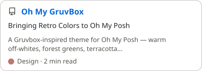
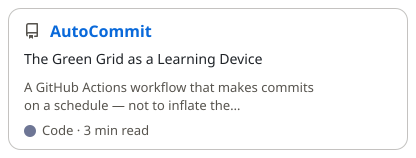
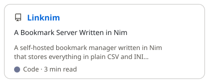
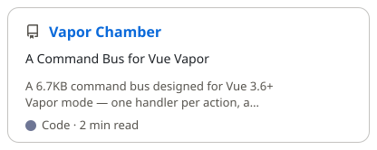
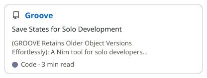
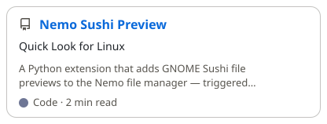

    <picture>
         
    </picture>
     
    <picture>
        
    </picture>

    &nbsp;
    
     
    &nbsp;
    
     
    &nbsp;
    

    <picture>
        
    </picture>

    <picture>
        
    </picture>

 

<!-- BLOG-POST-LIST:START -->

&nbsp;

 
&nbsp;

 
&nbsp;

<!-- BLOG-POST-LIST:END -->
